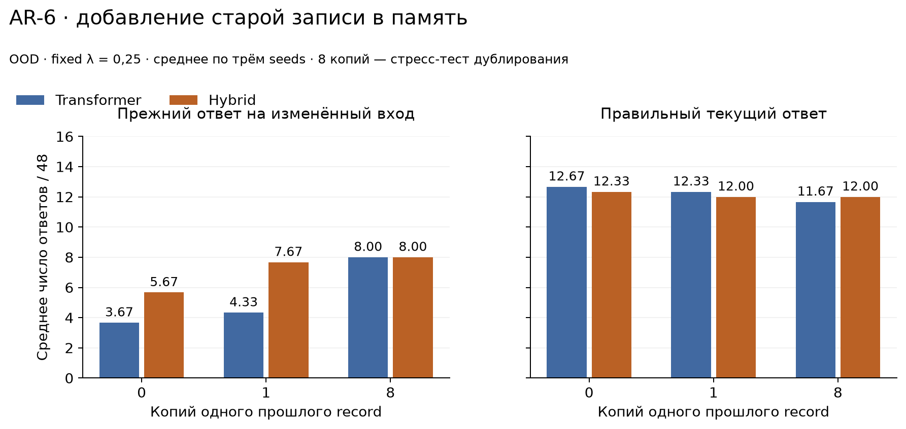
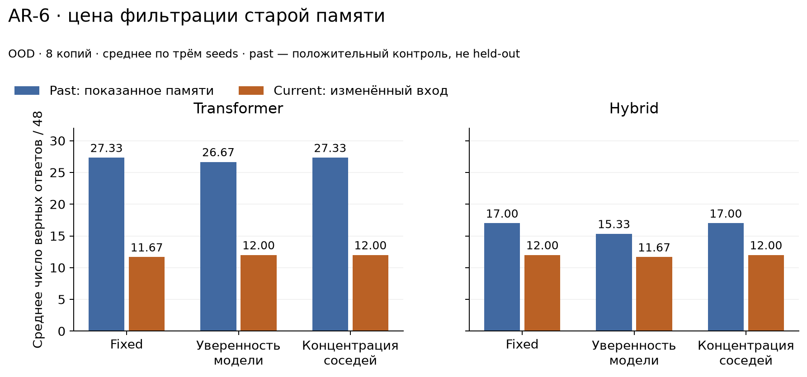

# AR-6 — устаревшая запись в kNN-памяти и простые фильтры

[Продолжение AR-3](../AR-3-knn-memory/README.md) · 11 ноября 2026 · Astrelik Research Lab

**Вопрос:** увеличивает ли добавление устаревшей записи повтор прежнего ответа на изменённый вход, и помогают ли простые фильтры вероятностей?

## Итог

Контролируемое добавление старой записи увеличило повтор прежнего ответа на изменённый вход. При восьми копиях старого record на OOD-панели это произошло у каждого из шести checkpoints. При обычном смешивании среднее число завершённых старых ответов выросло с 3,67 до 8 из 48 для Transformer и с 5,67 до 8 из 48 для hybrid.

Проверенные фильтры не дали устойчивого решения. Концентрация соседей немного помогла Transformer, но на OOD hybrid при высокой плотности не изменила точность. Фильтр уверенности модели иногда улучшал current, но терял часть пользы на past и местами ухудшал current. Это результат двух конкретных заранее заданных эвристик, не отрицание адаптивной памяти вообще.

## Чем продолжение отличается от AR-3

В AR-3 повтор прежней строки был наблюдаемым типом ошибки, но не доказывал причинность памяти. Здесь для каждого фиксированного входа изменяется только состав индекса: исходный train background дополняется предоставленной прошлой записью. Доли вмешательства 0/1/8 определены до первого forward. Можно сравнить одинаковый current-вход при наличии и отсутствии записи, сохраняя модель и политику.

Восемь копий — искусственное усиление одного record, не восемь независимых фактов. Это стресс-тест дублирования. Уровень 1 сохранён отдельно; отрицательный исход уровня 8 не выдаётся за обычный масштаб реального datastore.

Внешняя память на основе распределения соседей опирается на [kNN-LM](https://arxiv.org/abs/1911.00172). Использование уверенности модели для устойчивости к шумным соседям уже изучалось, например в [Towards Robust kNN-MT](https://arxiv.org/abs/2210.08808). Здесь нет обученной метасети, robust training или воспроизведения этих translation-экспериментов; новый общий метод не заявляется.

## Протокол, модели и данные

До вычислений закреплены 273 хеша источников, 96 пар, фильтры, пороги, ресурсные лимиты и условия пилота. Публичные параметры сохранены в `protocol` внутри [архива измерений](evidence/measurements.json.gz), хеш исходного технического протокола — в [provenance.json](evidence/provenance.json). Используются те же шесть замороженных моделей AR-3: Transformer и hybrid_attention_reference, seeds 17/29/43, ширина 160, словарь 260, контекст 256. Веса и прежние train-only индексы не перезаписывались. Ноль optimizer steps, GPU 0.

Сгенерированы 48 IID и 48 OOD пар, по 16 на семейство/split:

- RECALL: меняется значение запрошенного ключа;
- UPDATE: меняется последняя запись запрошенного ключа;
- COUNTER: меняется начальное значение счётчика на 1.

В каждой паре правильный ответ обязательно меняется. Эталон вычисляется отдельным текстовым oracle. IID/OOD относятся к тому же процедурному генератору; OOD отличается длиной и для ключевых задач алфавитом ключей. Это не независимый реальный домен. Кандидаты с каноническими совпадениями известных train/development входов отвергались до отбора; в FACTS/INIT нормализуется порядок, в COUNTER — порядок коммутирующих операций. 192 входа не совпадают с известными нормализованными условиями; это не доказательство независимости всех семантических шаблонов. Final-наборы не читались.

### Запись в память

Для каждой пары индекс сбрасывается к train background. По прошлому prompt и его известному правильному ответу выполняются teacher-forced forward: ключ перед выходной головой и целевой токен, включая EOS. Старый ответ предоставляется как уже известная запись, а не обязательно как прежняя генерация самой модели. Затем извлечённые строки добавляются 0/1/8 раз.

Current gold не поступает в извлечение, смешивание или gate; он используется только аудитом. Политика не получает возраст record, идентичность support или parsed oracle. Вход current уже содержит изменённый факт. Оценка past выполняется после записи: это механический положительный контроль на показанном содержимом, не held-out-оценка обобщения.

Индекс с добавлением нельзя называть train-only: у него два явно обозначенных источника — train и past support. Индекс не накапливает историю между парами и не моделирует полный многодневный диалог.

### Политики

Во всех вариантах k=8, квадрат евклидова расстояния, температура 1. Распределение соседей строится с весами `exp(-distance)`, ничьи решаются по исходному индексу строки. Декодирование жадное, максимум 8 новых токенов.

| Режим | Вес внешней памяти |
|---|---|
| base | 0, индекс не используется |
| fixed | Всегда 0,25 |
| model_confidence | 0 при max вероятности модели ≥0,5, иначе 0,25 |
| neighbor_concentration | 0,25 при max вероятности kNN ≥0,75, иначе 0 |

Это фильтры вероятностей, не семантическое разрешение конфликта или проверка актуальности по timestamp. Пороги не подбирались по результатам. Уверенность модели и согласие соседей могут быть ошибочными.

## Пилот и проверка вычислений

На двух seed 17 моделях выполнены 12 пар из заранее выбранной основной панели, 240 ответов на модель. Механический gate требовал: совпадения чистой kNN-математики с frozen kernel в пределах 1e-10, попадания support в top8 хотя бы одного current-запроса на модель и неизменности весов/индекса. Выигрыш качества не являлся условием продолжения.

Пилот прошёл: max-ошибка чистого распределения 0; current-support встретился в 3/12 парах Transformer и 5/12 hybrid. Два сеанса заняли суммарно 7,095 с wall-clock. После этого выполнена полная оценка всех моделей, без tuning/retry. Все 480 пилотных ответов точно повторились в основном запуске, но не считаются независимыми повторениями.

Основная оценка — **11 520 ответов**, пилот отдельно 480. Стандартная библиотека повторно проверила oracle/точные строки/EOS и **24 955 токенных трасс**: расстояния/значения top8, распределение и массу support, λ и выбранный токен. Для смеси достаточно сохранить вероятности модели на union(top1 модели, значения соседей): токен вне этого множества не получает добавочной массы и не может превзойти его максимум. Аудит проверяет эту реконструкцию с численным допуском 1e-10.

Семь unit-тестов проверяют влияние дубликатов, стабильные ничьи, границы gates, уверенную неправильную память, реконструкцию решений, точный oracle и обязательность EOS. Все 273 исходных хеша и fingerprints моделей после запусков совпали.

Основные шесть сеансов заняли **86,828 с wall-clock** с внешними обёртками, без подготовки/разработки. Это не сумма процессорного времени потоков и не benchmark скорости архитектур. Один worker, 4 torch-потока и 1 OpenBLAS-поток, 120/150 с внутренний/внешний лимиты; ни один лимит не достигнут. Среда AR-4 использована без изменения: Python 3.11.9, PyTorch 2.7.1+cpu, NumPy 2.2.6. Новые зависимости не устанавливались.

## Результаты

Каждая строка ниже — среднее по трём seeds, знаменатель 48 задач/пар на split. Дробь возникает при усреднении; это не доверительный интервал. Архитектуры не объединяются в один итог.

### Добавление старой записи: fixed, OOD

| Архитектура | Копий | Верных past | Верных current | Завершённых старых ответов на current |
|---|---:|---:|---:|---:|
| Transformer | 0 | 10,67 | 12,67 | 3,67 |
| Transformer | 1 | 23,00 | 12,33 | 4,33 |
| Transformer | 8 | 27,33 | 11,67 | 8,00 |
| Hybrid | 0 | 13,33 | 12,33 | 5,67 |
| Hybrid | 1 | 17,00 | 12,00 | 7,67 |
| Hybrid | 8 | 17,00 | 12,00 | 8,00 |

Память заметно помогает на старом входе, который ей показали. Но применение той же записи к изменённому входу увеличивает повторы прошлого ответа. Эти повторы не равнозначны потере правильного ответа: часть превращает одну ошибку в другую.



[Векторная версия графика](figures/stale-intervention.svg). Показаны средние количества из 48, без доверительных интервалов; восемь копий — стресс-тест дублирования одной записи.

Попарные OOD-изменения fixed при добавлении 8 копий относительно 0:

| Архитектура | Seed | current: 0→8 копий | Старые ответы: 0→8 копий |
|---|---:|---:|---:|
| Transformer | 17 | 12→11 | 3→7 |
| Transformer | 29 | 9→9 | 3→8 |
| Transformer | 43 | 17→15 | 5→9 |
| Hybrid | 17 | 13→14 | 5→9 |
| Hybrid | 29 | 13→11 | 6→7 |
| Hybrid | 43 | 11→11 | 6→8 |

У hybrid seed 17 точность даже растёт на 1, одновременно добавляются 4 старых ответа. Поэтому вывод «старая память всегда снижает точность каждого запуска» неверен. Поддержан более узкий вывод: в этом вмешательстве частота завершённых старых ответов выросла у всех шести checkpoints. [stale_effects.csv](metrics/stale_effects.csv) хранит gains/losses и введённые/устранённые повторы отдельно.

### Фильтры и цена защиты

Верные current-ответы, среднее из 48. Base не использует индекс; fixed0 — прежний train background; остальные столбцы — 8 копий прошлой записи.

| Архитектура | Split | base | fixed0 | fixed8 | model_confidence8 | neighbor_concentration8 |
|---|---|---:|---:|---:|---:|---:|
| Transformer | IID | 19,67 | 20,00 | 19,00 | 18,67 | 19,33 |
| Transformer | OOD | 13,67 | 12,67 | 11,67 | 12,00 | 12,00 |
| Hybrid | IID | 23,33 | 21,33 | 21,67 | 22,33 | 22,00 |
| Hybrid | OOD | 12,67 | 12,33 | 12,00 | 11,67 | 12,00 |

На OOD Transformer при 8 копиях фильтр концентрации уменьшает среднее число старых ответов 8→6,67 и повышает current 11,67→12. Это небольшой эффект, а не восстановление уровня base 13,67. По seeds current fixed8→concentration8: 11→11,9→9,15→16. У hybrid те же current14/11/11 и counts старых ответов 9/7/8 сохраняются.

Фильтр уверенности модели на том же OOD сохраняет меньше полезных past-ответов: Transformer 27,33→26,67, hybrid 17→15,33. Current у Transformer повышается на 0,33 в среднем, у hybrid уменьшается на 0,33. Он не является безопасной заменой fixed.

На первом токене current при 8 копиях fixed включает память во всех 48 случаях. Фильтр уверенности включает её в среднем 18,33/48 для Transformer и 6,33/48 для hybrid; концентрация — 42/48 и 46,67/48. Это счётчик **первого токена**, не доля всей генерации. Большое отключение памяти само по себе не означает большего качества.



[Векторная версия графика](figures/filter-tradeoff.svg). Past содержит показанный памяти ответ и служит положительным контролем; это не оценка на невиданных данных.

### Пример границы фильтра

В паре `ar6-iid-045` (COUNTER), Transformer seed 29, правильный прошлый ответ `-2`, текущий `-1`. При fixed0 получен `-1`, при fixed8 —`-2`. На позиции ошибочного символа память имеет max-вероятность 1 и массу support 1; модель даёт этому токену top1 с вероятностью ≈0,415. Концентрация принимает уверенную старую подсказку, а порог уверенности модели 0,5 тоже её не отвергает. Это иллюстрация из исходной панели, выбранная после результатов, не отдельный подтверждающий опыт.

## Определения и полнота результатов

Точный правильный ответ требует совпадения строки и естественного EOS. «Завершённый старый ответ» на current также требует EOS и валидного ASCII; его строка равна past gold, отличному от current gold. Условный показатель «старый ответ после правильного past» использует другой знаменатель — число правильных past. Например, суммарно на OOD fixed8: 20/82 для Transformer и 19/51 для hybrid. Эти отношения не являются безусловными частотами по всем 144 парам, и состав подмножества зависит от режима.

Все уровни, политики, архитектуры и seeds доступны в [scores.csv](metrics/scores.csv), [pairs.csv](metrics/pairs.csv), разрезы по 16 задачам каждого семейства — [families.csv](metrics/families.csv). Попарная цена фильтра относительно fixed в тех же условиях — [filter_tradeoffs.csv](metrics/filter_tradeoffs.csv). Отрицательные, нулевые и положительные исходы сохранены; успешные модели или панели не выбирались после просмотра.

## Ограничения и вывод

Один процедурный генератор, 96 пар и две конкретные маленькие архитектуры ограничивают обобщение. Используются три существующих training seeds, но общие задачи не являются независимыми наблюдениями между checkpoints. Пороговые эвристики не обучались и не подбирались. Многократное копирование одного record — искусственное воздействие, не модель распределения всех реальных баз знаний. Past-контроль намеренно содержит показанный памяти ответ. Не проверены timestamp-aware обновление, learned gating, другие λ/k, большие модели или длительная накопительная память. Final-оценка, интервалы и статистическая значимость не заявляются.

В заявленных условиях старая запись действительно меняет поведение памяти и увеличивает повтор прежнего ответа. Простая концентрация соседей не измеряет актуальность, а уверенность модели не даёт бесплатной защиты без потерь. Нельзя объявлять найденным устойчивый способ устранения конфликтов.

## Проверка опубликованных результатов

Из папки исследования, Python 3.11 или новее:

```sh
python -B code/analyze.py
python -B -m unittest discover -s code -p "test_analysis.py"
```

Анализ требует только стандартной библиотеки. Он проверяет контрольные суммы, 96 синтетических пар и их эталоны, переоценивает 11 520 основных ответов и 24 955 токенных решений, сопоставляет 480 ответов пилота с основной оценкой и пересоздаёт все пять CSV. Четыре публичных теста проверяют реконструкцию решений, обязательность EOS, последнюю запись UPDATE и недопустимость второго изменения в паре. Семь технических тестов, упомянутых выше, дополнительно проверяли исходную реализацию памяти до публикации.

В [cases.json](evidence/cases.json) находятся все пары. [measurements.json.gz](evidence/measurements.json.gz) — сжатый JSON со всеми основными и пилотными ответами, токенными трассами, квитанциями добавленных строк и параметрами опыта. Он читается обычными `gzip` и `json`; это данные измерений, а не модель. [provenance.json](evidence/provenance.json) фиксирует происхождение, хеши и исходную среду. Хеши известных нормализованных учебных входов позволяют проверить отсутствие точных канонических совпадений без публикации исходного корпуса.

**Граница воспроизводимости:** пакет воспроизводит анализ сохранённых решений. Он не пересоздаёт эмбеддинги, поиск соседей и ответы модели с нуля: веса, исходные индексы, технические launchers и окружение не включены. Трассы позволяют проверить расчёт смеси и выбор токенов при сохранённых расстояниях и вероятностях, но не независимо вычислить эти исходные величины.

Для необязательного перестроения графиков установите Matplotlib:

```sh
python -m pip install -r code/requirements-figures.txt
python -B code/render.py
```

## Авторство и лицензии

Astrelik Research Lab (2026). AR-6 — устаревшая запись в kNN-памяти и простые фильтры.

ИИ помогал с кодом, проверками, анализом и текстом. Измерения получены из реальных запусков; независимое рецензирование не проводилось.

Текст, графики и измерения — [CC BY 4.0](../../../LICENSE); код — [MIT](../../../LICENSE-CODE). При использовании укажите автора, ссылку на исследование и лицензию, а также внесённые изменения.
