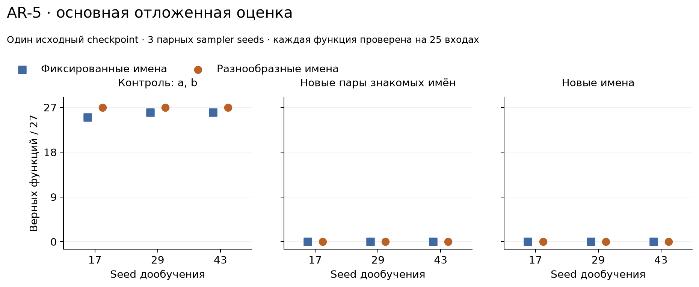
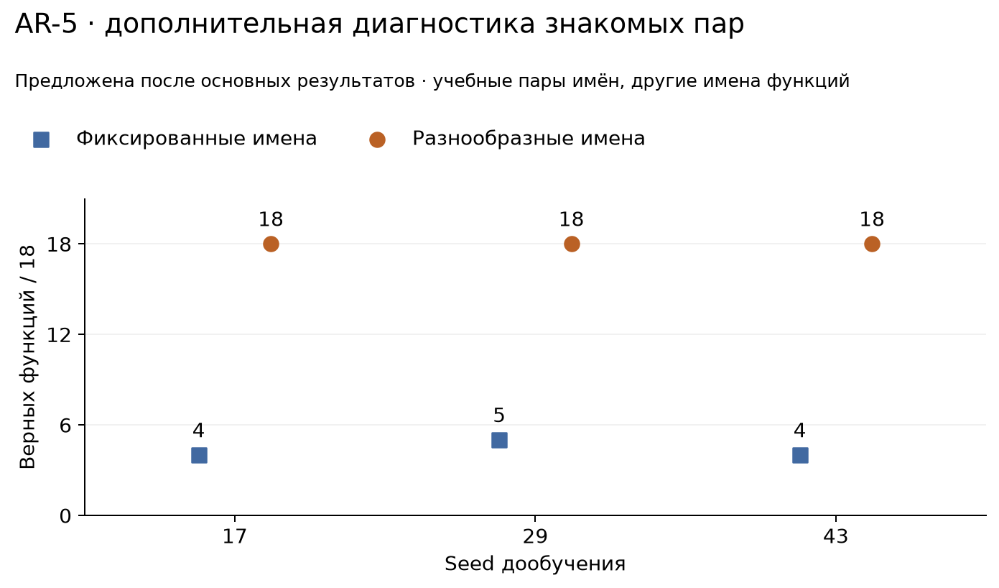

# AR-5 — разнообразие имён и перенос привязки аргументов

Astrelik Research Lab · 9 ноября 2026 · завершённое ограниченное исследование

## Результат

На маленькой гибридной модели разнообразие учебных имён не обеспечило перенос на новые пары знакомых имён или на новые имена: обе ветки получили **0/27** в каждой из этих панелей для всех трёх sampler seeds. При этом обе ветки решили все 12 учебных fit-проб, а разнообразная ветка — все 27 контрольных функций с `a,b` для каждого seed.

Дополнительная диагностика, предложенная **после** основных результатов, показала: разнообразная ветка переносит знакомые учебные пары имён на другие названия функций — **18/18** для каждого seed против **4, 5, 4 из 18** у фиксированной ветки. Это отделяет перенос знакомых пар от переноса на новые комбинации. Результат согласуется с использованием знакомых парных шаблонов, но внутренний механизм этим опытом не установлен.

## Вопрос и предыдущие работы

Вопрос: **помогает ли контролируемое разнообразие имён при дообучении использовать аргументы арифметической функции после переименования?** Обе ветки стартуют от одного исходного checkpoint; исходные веса и архитектура не меняются между условиями.

Устойчивость моделей к переименованиям уже исследовалась, например в [ContraBERT](https://arxiv.org/abs/2301.09072). Здесь не воспроизводится её контрастивное обучение и не заявляется новый общий метод. Проверяется узкий контролируемый вопрос на нашем стенде.

## Модель и фактор сравнения

Одна исходная `LanguageBackbone`: гибрид SSM/attention, **2 630 408 параметров**, ширина 192, словарь 4096, контекст 256. Исходный checkpoint после 4096 шагов имеет seed 17. В AR-5 используются три **парных sampler seeds** 17/29/43: они меняют выборку при дообучении, но не исходные предобученные веса. Это не три независимых предобучения.

Ветки:

- `fixed`: во всех учебных функциях аргументы `a,b`;
- `varied`: шесть сбалансированных пар `a,b / b,a / m,n / n,m / x,y / y,x`.

Три операции: сложение, вычитание, умножение. В каждой ветке 36 функций, по 12 на операцию. Для каждой пары записей совпадают операция, имя функции, длина полного токенизированного документа, длина prefix и число целевых токенов. Изменяются имена аргументов в сигнатуре, комментарии и return. Порядок выборки одинаков внутри пары seeds.

Токенизатор неизменён. Специально исключён эффект неодинаковой длины: не всякая пара коротких имён занимает одинаковое число BPE-токенов, поэтому равенство проверяется фактически на всех записях. Операции и объём данных не увеличиваются у varied; увеличивается разнообразие имён.

## Обучение и контроль усвоения

Каждая ветка начинает с тех же весов и **нового AdamW**, без переноса старых optimizer moments. Фиксированы 256 обновлений, batch 8, microbatch 2, LR 3e-4, betas 0.9/0.95, weight_decay 0.01, clip norm 1. Обучаются только токены после `return`, включая EOS; prefix и padding замаскированы.

На один запуск: **2048 выборок функций и 10 240 целевых токенов**. На шесть запусков — 1536 обновлений и 61 440 целевых токенов. Длина батча динамическая, с правым padding, без обрезания исходной функции. Одинаковые sampled indices, маски и target budgets независимо сверены.

Перед просмотром отложенных outputs проведён пилот seed 17: 12 фиксированных учебных проб, по 4 на операцию. Gate заранее требовал минимум 9/12 и минимум 3/4 для каждой операции **у обеих веток**. Обе получили 12/12, по 4/4 на операцию. Только затем выполнены seeds 29/43 и отложенная оценка. Их fit-пробы тоже дали 12/12 для каждой ветки. Это усвоение ограниченного поднабора train, не оценка всех 36 учебных функций и не доказательство обобщения.

Веса сохраняются как технические task-only checkpoints, не принимаются как улучшенная общая модель. Replay отсутствует; сохранность старых языковых/кодовых способностей здесь не оценивалась.

## Основная отложенная оценка

По 27 функций на панель, 9 на операцию. Названия функций `h000…h026` не встречаются в текущем дообучении. Каждая функция имеет три согласованные версии:

| Панель | Аргументы | Что меняется относительно дообучения |
|---|---|---|
| control | a,b | Другие названия функций |
| recombined | a,n / m,y / x,b | Другие названия функций и новые пары знакомых varied символов |
| unseen | u,v / r,s / c,d | Другие названия функций и символы вне AR-5 train |

Внутри каждой тройки совпадают длины tokenized input/targets. У baseline fixed большинство символов recombined также не встречались в этом дообучении; «знакомые» здесь относится к varied. «Unseen» означает невстречавшиеся в AR-5 train, не доказанную новизну относительно исходного предобучения.

Каждая функция проверяется на 25 парах целых значений из `[-7,-1,0,2,9]²`. Измеряем долю **функций**, правильных на всех 25 входах и завершённых естественным EOS. Это конечная проверка, не формальное доказательство для всех чисел. Сгенерированный Python не исполняется: применяется ограниченный AST-интерпретатор. Синтаксис, естественный EOS, неизвестные имена и функциональность учитываются отдельно.

| Sampler seed | control fixed | control varied | recombined fixed | recombined varied | unseen fixed | unseen varied |
|---|---:|---:|---:|---:|---:|---:|
| 17 | 25/27 | 27/27 | 0/27 | 0/27 | 0/27 | 0/27 |
| 29 | 26/27 | 27/27 | 0/27 | 0/27 | 0/27 | 0/27 |
| 43 | 26/27 | 27/27 | 0/27 | 0/27 | 0/27 | 0/27 |



На всех 486 основных генерациях синтаксис корректен и присутствует естественный EOS. Но все 324 ответа двух неконтрольных панелей содержат хотя бы одно имя, отсутствующее в сигнатуре. Например, varied seed 17 для сигнатуры `h000(a,n)` и инструкции сложить аргументы возвращает `m + n`, а для `h000(u,v)` — `m + n`. Проблема не сводится к формату или остановке.

Ни у одного checkpoint нет тройки, где правильны все три версии функции: 0/27 для каждого запуска. Полные разрезы — [scores.csv](metrics/scores.csv), [operations.csv](metrics/operations.csv), [paired.csv](metrics/paired.csv) и [triplets.csv](metrics/triplets.csv).

## Дополнительная диагностика: знакомые пары

Основной протокол уже был завершён и проверен, когда возник вопрос: умеет ли varied переносить хотя бы те пары имён, на которых обучалась? Для ответа создан **отдельный post-hoc протокол**, затем получены новые outputs без обучения и выбора checkpoint.

Панель содержит 18 функций: все шесть учебных пар × три операции, с названиями из `h000…h026`. Эти названия уже использовались в основной оценке; диагностика не является новым независимым подтверждением. Пары заранее полностью перечислены в отдельном диагностическом протоколе; не выбирались по удачным ответам.

| Sampler seed | fixed | varied |
|---|---:|---:|
| 17 | 4/18 | 18/18 |
| 29 | 5/18 | 18/18 |
| 43 | 4/18 | 18/18 |



Панель асимметрична по учебной экспозиции: varied видела все шесть пар, fixed — только a,b. Она полезна для уточнения границы результата, но её положительный исход не заменяет нулевой итог заранее закреплённых recombined/unseen. Успех fixed на обратной паре для коммутативных операций также не равнозначен правильной привязке каждой позиции; вычитание оценивается отдельно.

Данные и outputs диагностики сохранены отдельно в [measurements.json](evidence/measurements.json), сводка — [diagnostic.csv](metrics/diagnostic.csv).

## Проверки, ресурсы и воспроизведение

Выполнено шесть новых дообучений, шесть основных оценок и одна дополнительная диагностика. Один CPU-worker, 4 потока, GPU 0. На train/eval действовали лимиты 120 с внутренний / 150 с внешний, на диагностический пакет 90/120 с. Ни лимиты, ни обучение, ни параметры не расширялись после исходов; неудачных попыток и автоматических retries нет.

Суммарное wall-clock время 12 основных сеансов с обёртками — **146,14 с**, отдельно диагностика около 3,39 с. Разработка, подготовка данных и установка tokenizers сюда не входят; это не сумма процессорного времени потоков.

Сверены хеши 41 исходного файла основного протокола, общий отпечаток исходных весов, по 256 записей истории обучения на запуск, совпадение индексов, масок и числа целевых токенов, хеши всех шести checkpoints. Повторно переоценены **558 основных ответов** (72 fit + 486 evaluation) и 108 диагностических, всего 666. Пересчёт не запускал модель заново. Пять технических unit-тестов и семь аналитических примеров безопасного AST-grader проходят; оба графика просмотрены.

Среда измерений: Python 3.11.9, PyTorch 2.7.1+cpu, NumPy 2.2.6, tokenizers 0.22.1. Для публичного пересчёта эти библиотеки не нужны: он работает на стандартной библиотеке Python.

### Публичное воспроизведение

Из папки исследования, Python 3.11+:

```sh
python -B code/analyze.py
python -B -m unittest discover -s code -p test_analysis.py
```

Скрипт проверяет эталоны по арифметическому oracle, байты и EOS всех 666 ответов, fit-gate, совпадение исходных весов по fingerprints, индексы выборки, маски и бюджеты. Все шесть CSV в metrics/ пересоздаются: scores, operations, training, paired, triplets и diagnostic. Четыре публичных unit-теста включают семь аналитических примеров безопасного интерпретатора.

[measurements.json](evidence/measurements.json) содержит все собственные синтетические задания, сохранённые ответы и истории обучения. Таблица байтов только использованных токенов позволяет проверять декодирование без полной BPE-модели; она не заменяет токенизатор для новых входов. [provenance.json](evidence/provenance.json) хранит хеши технических источников и checkpoints, параметры среды и сводку проверок. Хеши документируют происхождение, но соответствующие технические файлы не нужны для этих команд.

Для графиков отдельно: `python -m pip install -r code/requirements-figures.txt`, затем `python -B code/render.py`. Векторные версии: [основная оценка](figures/primary.svg), [дополнительная диагностика](figures/posthoc-seen-pairs.svg).

Checkpoints, исходные корпусные тексты предобучения, полный токенизатор, окружения и технические launchers не включены. Публичные команды воспроизводят **анализ сохранённых измерений**, а не обучение или получение ответов моделью с нуля. Шесть фактических дообучений выполнены технически и описаны выше.

## Вывод и ограничения

В этих условиях разнообразие имён позволило переносить **знакомые пары** на другие названия функций, но не обеспечило перенос на новые сочетания знакомых символов или на новые символы. Общую устойчивую привязку аргументов из этих результатов заключать нельзя.

Ограничения: один исходный checkpoint и три sampler seeds; 36 учебных функций, только одношаговая арифметика с короткими латинскими именами; 256 шагов конкретного AdamW; известные operation keywords; ограниченный тестовый grid; отсутствие новых комбинаций операций, retention-оценки и независимого final-корпуса. Дополнительная положительная диагностика предложена после просмотра основных результатов. Нельзя переносить вывод на большую модель, другой бюджет/предобучение или аугментацию кода вообще. Доверительные интервалы и статистическая значимость не заявляются.

Работа отвечает на ограниченный вопрос, включая отрицательный основной исход. Положительная дополнительная диагностика не подменяет его.

ИИ помогал с кодом, проверками, анализом и текстом. Проверки пакета не являются независимым научным рецензированием.

Текст, графики и измерительные материалы — [CC BY 4.0](../../../LICENSE); программный код — [MIT](../../../LICENSE-CODE). Рекомендуемая ссылка: **Astrelik Research Lab (2026). AR-5 — разнообразие имён и перенос привязки аргументов.**
